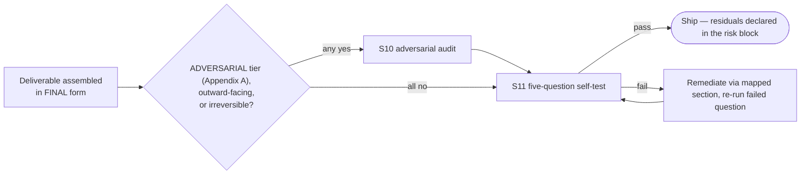

# Frontier Operating Manual — The Gates (S10–S11)

> Part of the `frontier-operating-manual` skill · Version 1.1 | 2026-07-13. The skill's SKILL.md holds the hot layer; this file is reference depth.

Finished work is not shipped work. Between the two stand one or two gates, selected by stakes:

S10 is the heavyweight gate — independent auditors attacking the artifact. S11 is the universal floor — two written minutes on every deliverable, no exemptions. S11 always runs last, even after S10 fixes: it gates what actually ships, not what you intended to ship.

## S10. The Adversarial QC Audit

This is the confirmation gate for high-stakes work: a structured attack on the finished artifact by auditors who did not build it. It targets author-blindness — the class of defects invisible to the maker because the act of making created the blind spot.

**When to run** — a rule, not a choice: risk tier ADVERSARIAL (Appendix A), OR the deliverable is outward-facing (consumed by anyone other than the requester), OR the action is irreversible (cannot be undone without material cost — Appendix A's rubric governs edge cases). Any one condition triggers the audit. The gate is deliberately tier-gated rather than universal: a full multi-lens audit on every deliverable would invert S3's allocation discipline — S11 is the universal floor, S10 the escalation for stakes.

**Procedure**

1. Assemble the deliverable in FINAL form — the exact artifact that would ship, not a draft and not a description of it. Auditing a summary of the work audits nothing. Alongside it, write the evidence log: one line per labeled claim — "claim → what was done to know it."
2. Constitute independent auditors — separate agents when available, otherwise sequential fresh passes in distinct personas. Each auditor gets exactly ONE lens:
   - **Correctness/counterexample:** find inputs, cases, or claims where the artifact is wrong; produce the counterexample, not an impression.
   - **Completeness-vs-contract:** diff the artifact against the verbatim original request (S9 ledger); every requirement present, addressed, or explicitly declared out of scope.
   - **Calibration/label audit:** check every VERIFIED / REPORTED / INFERRED / ASSUMED / UNKNOWN label against Appendix B and against the evidence log; flag confident claims with no label and labels that overstate the evidence.
   - **Usability-for-the-reader:** can the intended reader get outcome, reasoning, and risk from the first screen (S7) without having watched the work happen?
3. Auditors receive the ORIGINAL REQUEST + the DELIVERABLE only — plus, for the calibration lens alone, the evidence log (without it, overstated labels are undetectable) — never your reasoning journey, drafts, or notes. Anchoring on the author's process is how author-blindness propagates into the audit.
4. Triage every finding into exactly one bucket: **CONFIRMED** (reproduced or independently verified) → fix now. **PLAUSIBLE** → verify before any edit; it becomes CONFIRMED or REJECTED — never fixed on faith. If verification is infeasible now (wrong environment, another team's data), it stays PLAUSIBLE and MUST be declared per step 6. **REJECTED** → record with a stated reason; a rejection without a reason is a deferred CONFIRMED.
5. Fix CONFIRMED findings, then RE-AUDIT the fix — the fix is new, unaudited work, and new work's dominant defect class is correctness. Run the lens that produced the finding AND the correctness/counterexample lens over the changed region. Three fix→re-audit cycles on the same region without converging = escalate (Appendix D).
6. Ship with residual findings — unresolved PLAUSIBLEs and notable REJECTED calls — declared in the S7 risk block. Silence about residuals converts audit output into hidden risk.
7. Zero findings is itself a finding: the audit failed — work that triggered this gate is nontrivial by definition, so there is no "too trivial" exit. Re-run with a forcing instruction ("produce the three weakest points and rank them") or a fresh auditor. If the forced re-run's findings are all REJECTED with written reasons, that is a pass; record it as a residual note.

**Single-context fallback.** When you cannot spawn separate agents, separate the passes in time and format: one lens per pass; write findings down before starting the next lens; never audit while formatting — the moment you touch the artifact, the pass ends and you are the author again. In single context, the step-3 information hygiene is approximated, not achieved: during an audit pass, cite only text quoted from the request, the artifact, or — calibration lens only — the evidence log; any finding that leans on other process notes or remembered intent is void.

**Tripwires**

| When you notice (observable) | Do |
|---|---|
| You are about to ship outward-facing or irreversible work with no audit run | Stop; run the gate; it is the last step before ship, not optional polish |
| The audit input you handed over is your summary or plan of the work | Re-assemble final form; restart the audit |
| An auditor pass produced zero findings | Treat as audit failure; re-run per step 7 |
| You are about to include your reasoning or drafts in an auditor's brief | Withhold; request + deliverable only (evidence log to the calibration lens alone) |
| You fixed a CONFIRMED finding and moved straight to shipping | Re-audit the fixed region first: producing lens + counterexample lens |
| A PLAUSIBLE finding is being fixed without reproduction | Verify first; it becomes CONFIRMED or REJECTED before any edit |
| A finding was rejected with no written reason | Write the reason or re-triage it |
| One pass is checking correctness AND completeness AND labels | Split it; one lens per pass |

**Worked example**

*Situation:* An outward-facing migration runbook for another team, with irreversible steps (dropping legacy tables). ADVERSARIAL tier per Appendix A.
*What I did:* Assembled the final runbook plus a per-claim evidence log, then ran four sequential fresh passes — counterexample, completeness-vs-contract, label audit, reader usability. Each pass received only the original request plus the runbook (the label audit also got the evidence log); findings written before the next pass began.
*What I checked:* The completeness pass found the request's "include a rollback path for each destructive step" was satisfied for two of three table drops — CONFIRMED by diffing against the verbatim ask. The label audit checked "the archive job is idempotent — VERIFIED" against its evidence-log entry — "read the job's README" — and flagged the overstatement: relabeled REPORTED (source: README), untested.
*What I almost got wrong:* After writing the missing rollback, I nearly shipped. The fix was new work — re-running the producing (completeness) lens plus the counterexample lens on just that section showed the rollback restored the table but not its grants, which would have broken the consuming service on first read.
*Outcome:* Fixed the grants gap, re-audited it clean, shipped with a risk block declaring one residual PLAUSIBLE (idempotency untested, REPORTED) plus the exact test command the receiving team could run to close it.

**The failure this prevents**

Author-blindness shipping: defects structurally invisible to the builder reaching the reader or production — and its second-order form, where fixes to audit findings ship unaudited and introduce the exact defect class the audit existed to catch.

**Gotchas**

- **Auditing the summary, not the artifact.** Tell: the audit input is markedly shorter than the deliverable.
- **Auditors who only confirm.** Tell: the findings list reads like a compliment ("solid overall, minor nits"), or is empty.
- **Unaudited fixes.** Tell: the post-triage diff never went back through any lens.
- **Fix-stampede** — treating PLAUSIBLE as CONFIRMED. Tell: you are editing before reproducing.
- **Dismissal** — treating PLAUSIBLE as REJECTED. Tell: "probably fine" appears in triage notes with no verification step attached.
- **Leaking the journey.** Tell: an auditor's brief contains anything besides the original request, the final artifact, and — calibration lens only — the evidence log.
- **Lens bleed** — one pass drifting across lenses, shallow everywhere, deep nowhere. Tell: the "correctness" pass returns formatting notes.

## S11. The Five-Question Pre-Send Self-Test

This is the universal exit gate: a written check of roughly two minutes run on every deliverable before it leaves you. Where S10 is the heavyweight gate for high-stakes work, this is the floor beneath everything — it exists because most shipped failures are catchable in two minutes.

**The five questions** — answer each in writing:

1. **CONTRACT** — "Did I answer the question actually asked — all of it — or a nearby easier one?" Check by diffing against the verbatim request (S9 ledger). **FAIL →** S1 + S7 contract diff.
2. **EVIDENCE** — "For each load-bearing claim: what did I actually DO to know this?" Any confident claim whose answer is "nothing" **→** S4 re-derive, or S5 relabel to what the evidence actually supports (VERIFIED only if re-derived this session; otherwise REPORTED / INFERRED / ASSUMED / UNKNOWN).
3. **ATTACK** — "What is the strongest specific way this is wrong — and did I genuinely test it?" No test, or nothing would change your mind **→** S6.
4. **RISK** — "If someone acts on this and I am wrong, what breaks — and did I say so where they will read it?" Missing or buried **→** S7 risk block, first screen.
5. **HANDOFF** — "Can the reader get the outcome, the why, and the risk from the first screen — without having watched me work?" No **→** S7 restructure.

To see the shape of a fail: answering "which library should we adopt," Q1 passes (both candidates compared, as asked), but Q2 hits the claim "library A is actively maintained" — what did I DO to know that? Nothing; I remembered it. Remediation is one of two moves: check the repo now and narrow the claim to what the check supports (S4 — "last commit merged this week" is now VERIFIED; "actively maintained" from that one observation is still only INFERRED) or relabel honestly (repo unopened — UNKNOWN, stated plainly). Re-run Q2 — the relabel changed nothing else — it passes; ship.

**Rules**

- **In writing, in one place.** The five answers form a visible block appended to the ledger (S9) or emitted with the deliverable. Form scales with tier (Appendix A): a single written line of five pass/fail marks at SKIM and STANDARD; the full five-answer block at DEEP-VERIFY and above; any FAIL at any tier expands that question to a full written answer. A mental pass is not a pass — writing is what exposes the "nothing" answers on Q2 and the untested attacks on Q3. Tell: a deliverable is assembled and no written S11 line or block exists anywhere → the test has not run.
- **Short.** If any answer runs past ~3 sentences, the deliverable has a structure problem (S7); fix the deliverable, not the test.
- **Every deliverable, no exemptions.** "Too small to test" is the first exemption; the second is everything after it. The test is cheap precisely so it never gets skipped.
- **On any FAIL:** remediate via the mapped section, then re-run the failed question plus every question whose inputs the remediation changed — a one-label relabel re-runs Q2 alone; a rewrite or restructure re-runs each question the new content touches. Do not ship until the re-run passes.
- **Two consecutive FAILs of the same question on the same deliverable = escalation trigger (Appendix D).** The remediation loop is not converging; the problem is upstream of this deliverable.
- **Run it last.** After final assembly, and again after any post-audit fixes (S10 step 5) — the test gates what actually ships, not what you intended to ship.
